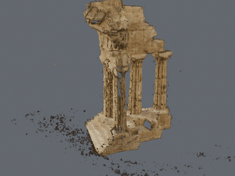
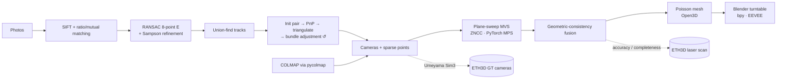
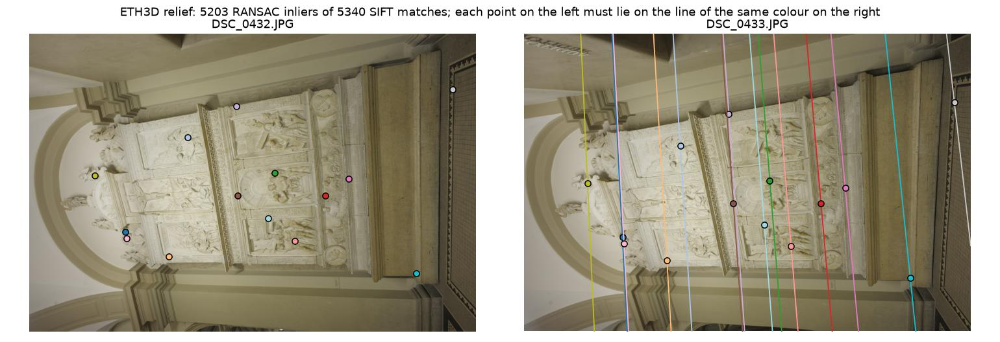
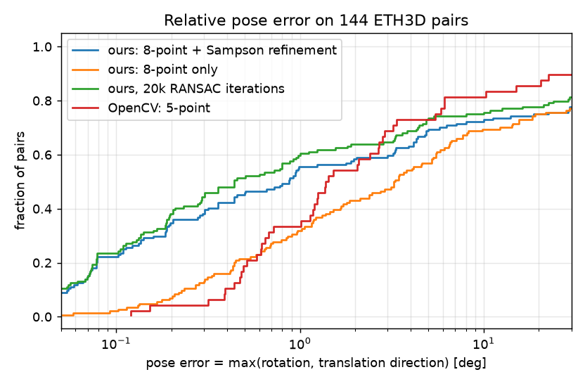
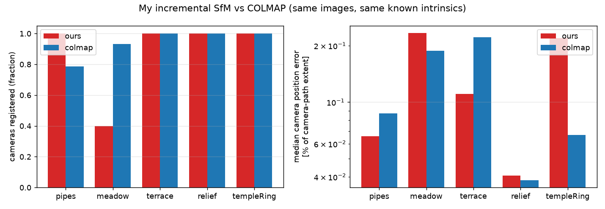
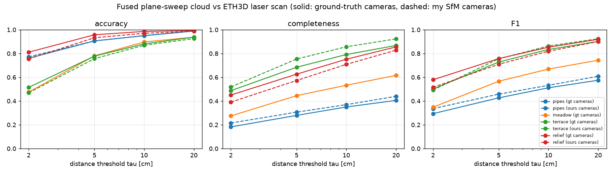
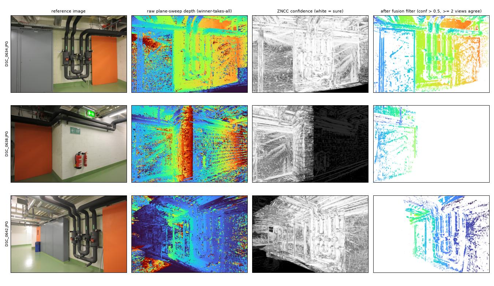
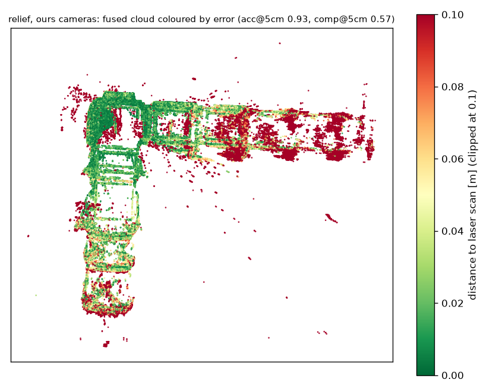
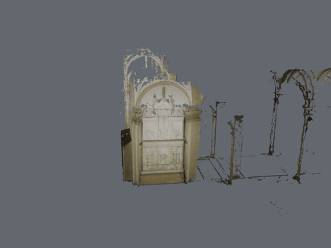

<div align="center">

# 🏛️ Multi-view 3D Reconstruction: photos → cameras → dense mesh → Blender

**Structure-from-Motion written from scratch (8-point RANSAC, triangulation, PnP, sparse bundle adjustment) and benchmarked against COLMAP, a plane-sweep multi-view stereo that runs on the Apple GPU, Poisson meshing and an automated Blender turntable. Every stage is scored against ETH3D's ground-truth cameras and laser scans.**

[](https://github.com/haroonkhan02/multiview-3d-reconstruction-blender/actions/workflows/ci.yml)




<sub>Middlebury templeRing (47 photos, 640 × 480): cameras from **my own SfM**, depth from the plane sweep, Poisson mesh, rendered headless in Blender 5.1 with EEVEE. The black cloth under the temple is hidden in the render only (`--min-brightness`); the evaluated meshes are never filtered this way.</sub>

</div>

---

## Highlights

- **The geometry is written from scratch, and checked.** Hartley-normalised 8-point F/E, RANSAC with Sampson error, a non-linear refinement of E, the four-fold pose decomposition with cheirality, DLT triangulation, union-find tracks and bundle adjustment with a sparse Jacobian in SciPy. OpenCV is only used for SIFT, PnP and image I/O. 32 unit tests check all of it on synthetic scenes with known answers.
- **Benchmarked against the real thing.** On the same images, with the same known intrinsics, my incremental SfM registers **every camera on 4 of 5 scenes**, with median position errors of **0.2–0.9 cm** on the ETH3D scenes. That is as good as COLMAP, or better, on pipes and terrace; COLMAP is 15–100× faster. My SfM fails on meadow (6/15 cameras vs 14/15) and I show why.
- **A solver lesson in one table.** On 48 ETH3D image pairs, my 8-point solver is *more precise* than OpenCV's 5-point (AUC@5° 0.621 vs 0.546). OpenCV's is *more robust* on the hardest pairs (AUC@20° 0.759 vs 0.729): a 5-point sample is all-inlier far more often than an 8-point one.
- **Dense stereo on the Apple M5 GPU.** The plane sweep uses ZNCC, 192 inverse-depth planes and 5 source views per image, at ~7.6 s per 800 px view. Fusion keeps a depth only where other views confirm it. Against the laser scans, **93–96 % of the fused points on relief lie within 5 cm**; completeness (with ground-truth cameras) varies with texture, from 0.28 (white walls) to 0.68 (terrace).
- **Bugs found by questioning results that looked too good or too bad.** For example, a "perfect" 0.000° COLMAP rotation error came from unnormalised ETH3D quaternions combined with an `arccos` near 0°. I fixed each one and re-ran everything (see *What went wrong*).

## Pipeline



## Results

All numbers come from runs on an Apple M5 (16 GB) and are stored in `reports/*/results.json`. `reports/tables.md` lists them all. Images are processed at 1600 px (SfM) and 800 px (dense); ETH3D originals are 6220 × 4141.

### 1 · Two-view relative pose (48 ETH3D pairs × 3 RANSAC seeds = 144 runs)

| Solver (same SIFT matches) | AUC@5° | AUC@10° | AUC@20° | Median rot. err. | Median transl. dir. err. | Median time |
|---|---|---|---|---|---|---|
| Ours: 8-point, no refinement | 0.423 | 0.540 | 0.630 | 0.83° | 3.27° | 129 ms |
| Ours: 8-point + Sampson refinement (2k iterations) | 0.571 | 0.643 | 0.693 | 0.45° | 0.81° | 162 ms |
| **Ours: same, 20k iterations** | **0.621** | **0.684** | 0.729 | **0.17°** | **0.44°** | 197 ms |
| OpenCV `findEssentialMat` (5-point) + `recoverPose` | 0.546 | 0.673 | **0.759** | 0.65° | 1.40° | 9 ms |

<sub>Pairs are spread over the ground-truth co-visibility range, from easy to nearly impossible, 12 per scene; pose error = max(rotation error, translation-direction error). The Sampson refinement is the biggest single gain (median translation error 3.27° → 0.81°). OpenCV's 5-point needs far fewer RANSAC samples at low inlier ratios (~2.8k vs ~105k at 30 % inliers), which is why it keeps the most hard pairs. My solver is pure NumPy/SciPy, hence ~20× slower. Command: `mv3d-twoview`.</sub>

<p align="center"></p>
<p align="center"></p>

### 2 · Incremental SfM vs COLMAP (camera poses vs ground truth)

| Scene (images) | Engine | Registered | 3D points | Reproj. error | Median rot. err. | Median / max position err. | Time |
|---|---|---|---|---|---|---|---|
| pipes (14) | **ours** | **14/14** | 4,336 | 0.24 px | 0.066° | **0.21** / 2.6 cm | 103 s |
| | COLMAP | 11/14 | 949 | 0.36 px | 0.142° | 0.26 / 0.9 cm | 5 s |
| meadow (15) | ours | 6/15 | 1,009 | 0.26 px | 1.05° | 3.0 / 6.4 cm | 138 s |
| | **COLMAP** | **14/15** | 810 | 0.43 px | 1.14° | 4.4 / 8.8 cm | 9 s |
| terrace (23) | **ours** | 23/23 | 18,987 | 0.25 px | **0.099°** | **0.85** / 2.4 cm | 353 s |
| | COLMAP | 23/23 | 5,730 | 0.43 px | 0.355° | 1.69 / 4.0 cm | 14 s |
| relief (31) | ours | 31/31 | 34,240 | 0.23 px | 0.073° | 0.24 / **56.4** cm | 680 s |
| | **COLMAP** | 31/31 | 15,417 | 0.30 px | **0.038°** | 0.23 / 0.7 cm | 20 s |
| templeRing (47) | ours | 47/47 | 11,960 | 0.26 px | 0.47° | 0.35 / 0.7 cm | 638 s |
| | **COLMAP** | 47/47 | 7,612 | 0.29 px | **0.18°** | **0.11** / 0.4 cm | 6 s |

<sub>Both engines get the same 1600 px images and the ground-truth intrinsics as a fixed pinhole camera. The reconstructions are aligned to the ground-truth camera centres with a similarity transform (Umeyama, refit without cameras above 3× the median error, so one outlier cannot tilt the rest); every camera is still scored. Temple distances are in the units of Middlebury's calibration files. COLMAP runs on CPU with default settings. On relief, one of my cameras (#19) is registered 56 cm off; COLMAP has no such outlier. My SfM keeps more points per image, but its tracks are shorter (2.5–4.5 vs 3.4–6.3 observations), because COLMAP merges and re-triangulates tracks and I don't. Command: `mv3d-sfm`.</sub>

<p align="center"></p>

**Meadow, the failure case.** The match graph of meadow (grass, a few far buildings) splits into clusters. After 6 images, the best candidates had 27–29 triangulated correspondences, just under my PnP minimum of 30. With a minimum of 20 inliers and a 1.5° triangulation angle it reaches 9/15 cameras (median 5.1 cm). That setting was chosen *after* looking at meadow, so it is not used in the table above (`ours_relaxed` in `reports/sfm/results.json`).

### 3 · Dense reconstruction vs the ETH3D laser scans

| Scene | Cameras | Fused points | Accuracy @2 / 5 / 10 cm | Completeness @2 / 5 / 10 cm | **F1 @5 cm** | Mesh F1 @5 cm |
|---|---|---|---|---|---|---|
| pipes | ground truth | 727k | 0.76 / 0.91 / 0.95 | 0.18 / 0.28 / 0.35 | 0.43 | 0.38 |
| pipes | **my SfM** | 752k | 0.77 / 0.91 / 0.95 | 0.21 / 0.31 / 0.37 | 0.46 | 0.42 |
| meadow | ground truth | 444k | 0.47 / 0.78 / 0.90 | 0.27 / 0.45 / 0.53 | 0.57 | 0.51 |
| terrace | ground truth | 2.11M | 0.51 / 0.78 / 0.88 | 0.49 / 0.68 / 0.79 | 0.73 | 0.67 |
| terrace | **my SfM** | 2.58M | 0.47 / 0.76 / 0.87 | 0.52 / 0.75 / 0.86 | 0.76 | 0.69 |
| relief | ground truth | 3.09M | 0.81 / 0.96 / 0.99 | 0.45 / 0.63 / 0.75 | 0.76 | 0.67 |
| relief | **my SfM** | 2.78M | 0.75 / 0.93 / 0.97 | 0.39 / 0.57 / 0.71 | 0.71 | 0.62 |

<sub>800 × 533 px, 192 depth planes, 5 source views, ZNCC 7 × 7, best-2-of-5 aggregation; a depth is kept if its ZNCC is > 0.5 and ≥ 2 other views confirm it (< 1 px, < 1 % depth). Plane sweep: 7.6 s per view on the M5 GPU (MPS); fusion and Poisson take seconds. The "my SfM" runs are in the ground-truth frame through the SfM similarity alignment. They also take their depth ranges and neighbour views from my sparse points instead of ETH3D's, so the small gains over ground-truth cameras on pipes and terrace come from that difference, not from better cameras. Metrics are a **simplified** ETH3D protocol: there is no masking of space the scanner never saw, only a bounding-box crop. The numbers are therefore not comparable with the official leaderboard, and accuracy is a lower bound. Command: `mv3d-dense --scene eth3d/<scene> --poses gt|ours`.</sub>

<p align="center"></p>
<p align="center"></p>
<p align="center"><sub>Pipes: the white walls have no texture, so ZNCC is flat over depth (dark in the confidence column) and the raw depth is noise. Fusion removes it, leaving holes. This is why completeness is 0.28 here and 0.68 on the textured terrace.</sub></p>
<p align="center"></p>

### 4 · What the fusion filter trades (cached depth maps, ground-truth cameras)

| Agreeing views required | pipes acc / comp / F1 @5 cm | relief acc / comp / F1 @5 cm |
|---|---|---|
| ≥ 1 | 0.82 / 0.48 / **0.60** | 0.91 / 0.75 / **0.83** |
| **≥ 2 (default)** | 0.91 / 0.28 / 0.43 | 0.96 / 0.63 / 0.76 |
| ≥ 3 | 0.93 / 0.14 / 0.24 | 0.98 / 0.43 / 0.60 |

<sub>ZNCC threshold 0.5 in this table; 0.3 and 0.7 are in `reports/tables.md` and `reports/dense/fusion_ablation.png`. Each extra agreeing view buys a few points of accuracy for a large loss of completeness. On these scenes F1 @5 cm would be highest with ≥ 1 view. The default of 2 was fixed before this ablation and is kept: it is the safer choice when a mesh has to be built from the cloud.</sub>

### 5 · Blender

`mv3d-render` runs Blender 5.1 headless (`--background --python`). It imports the PLY mesh with vertex colours and orients it from the cameras: the normal of the plane through the camera centres is "up". It then animates an orbit (a full 360° for an object, a ±25° swing for a facade), renders with EEVEE and encodes MP4 + GIF with ffmpeg. A 120-frame 960 × 720 turntable of the temple takes about a minute.

<p align="center"></p>

## What went wrong (and is fixed)

| Symptom | Cause | Fix |
|---|---|---|
| `OverflowError` inside RANSAC on hard pairs | `1 − w⁸` rounds to 1.0, `log(1) = 0`, iteration count = ∞ | `log1p` + guard |
| Linear 8-point E fits worse than the true E (0.82 vs 0.35 px Sampson on a synthetic scene) | It minimises an algebraic, not a geometric error | Sampson-error refinement over (R, t) |
| Hard pairs with < 10 correct matches | OpenCV SIFT's default contrast threshold keeps only 2–3k keypoints at 1600 px | contrast threshold 0.01 |
| Open3D Poisson aborts (`Failed to close loop`) on macOS | Multi-threaded Poisson in Open3D 0.20 | `n_threads=1` |
| COLMAP rotation error exactly 0.000° on relief | ETH3D quaternions (~7 decimals) not normalised, plus `arccos` near 0° | Normalise q; `atan2` rotation angle; everything re-run |
| Every relief camera of mine 0.54° off | One outlier camera tilted the least-squares alignment | Trimmed refit (applied to both engines) |
| Failed images never retried | Registration loop marked them failed forever | Retry after each success (did not fix meadow, see above) |

## Getting started

```bash
git clone https://github.com/haroonkhan02/multiview-3d-reconstruction-blender.git
cd multiview-3d-reconstruction-blender
uv venv --python 3.12 && source .venv/bin/activate
uv pip install -e ".[full,dev]"        # torch, open3d, pycolmap, py7zr + pytest/ruff
pytest -q                              # 32 tests, synthetic data only

mv3d-download eth3d --scenes pipes meadow terrace relief   # ~1.5 GB (2.1 GB extracted)
mv3d-download temple                                       # 11 MB
mv3d-twoview                                               # §1, ~2 min
mv3d-sfm                                                   # §2, ~35 min (my SfM is the slow part)
mv3d-dense --scene eth3d/relief --poses ours               # §3, ~4 min per scene
mv3d-render --scene middlebury/templeRing --poses ours --sweep 360 --min-brightness 0.15 \
            --distance 3.4 --gif assets/temple_turntable.gif   # needs Blender (or $BLENDER)
mv3d-plots                                                 # figures + reports/tables.md
```

`scripts/run_all.sh` runs everything in order. **Your own photos:** put 30–60 overlapping shots in a folder, then run `mv3d-sfm --scenes path/to/folder --engines colmap`, `mv3d-dense --scene path/to/folder --poses colmap` and `mv3d-render ...`. COLMAP is used for unknown cameras because it refines the focal length; my SfM assumes known intrinsics.

**GPU-only extras:** COLMAP's PatchMatch stereo and Gaussian Splatting need CUDA. `notebooks/colab_colmap_dense_and_splatting.ipynb` runs both on a free Colab T4 and scores COLMAP's dense cloud with this repo's metric code. It is written but **not yet run**, so no numbers from it appear here.

## Repository structure

```text
multiview-3d-reconstruction-blender/
├── src/mvrecon/
│   ├── geometry.py           # 8-point F/E, RANSAC, Sampson refinement, pose, triangulation, Umeyama
│   ├── features.py           # RootSIFT, ratio + mutual matching, per-scene cache
│   ├── datasets.py           # ETH3D (COLMAP text + laser scans), Middlebury, photo folders
│   ├── twoview.py            # mv3d-twoview: ours vs OpenCV relative pose benchmark
│   ├── bundle.py             # sparse bundle adjustment (SciPy least_squares, Huber)
│   ├── sfm.py                # incremental SfM: tracks, init pair, PnP, triangulation, BA loop
│   ├── colmap_sfm.py         # the same scene through pycolmap
│   ├── run_sfm.py            # mv3d-sfm: both engines, pose evaluation, PLY export, figures
│   ├── evaluate.py           # robust Sim3 alignment, pose errors, accuracy/completeness
│   ├── mvs.py                # plane-sweep MVS with ZNCC in PyTorch (MPS / CPU)
│   ├── fusion.py             # geometric-consistency fusion, voxel merge, Poisson meshing
│   ├── dense.py              # mv3d-dense: MVS → fusion → mesh → scan evaluation
│   ├── render.py             # mv3d-render: camera-derived orientation, Blender + ffmpeg
│   ├── blender_turntable.py  # the bpy script that runs inside Blender
│   ├── plots.py              # mv3d-plots: summary figures and reports/tables.md
│   └── download.py           # mv3d-download: ETH3D and Middlebury
├── tests/                    # 32 tests on synthetic scenes (no data, GPU or Blender)
├── reports/                  # results JSON + figures for every section above
├── assets/                   # README GIFs
├── notebooks/                # Colab: COLMAP dense + Gaussian Splatting (not run)
├── scripts/run_all.sh        # reproduces every number
└── .github/workflows/ci.yml  # ruff + pytest on Python 3.10–3.12
```

## Design decisions

- **8-point instead of 5-point in my solver.** The 5-point solver needs a degree-10 polynomial; the 8-point is linear algebra I can explain line by line. The benchmark makes its cost visible (RANSAC sample size) rather than hiding it.
- **Calibrated SfM.** ETH3D and Middlebury publish intrinsics, so both engines get them fixed. That isolates the pose problem and makes the comparison fair. Self-calibration is left to COLMAP for your own photos.
- **Plane sweep, not PatchMatch.** It is the simplest dense method that is still real. It maps directly onto GPU tensor operations (`grid_sample`, `avg_pool2d`), and its failure modes (textureless and slanted surfaces) are easy to see and explain.
- **Scoring against laser scans, not by eye.** Every stage has a ground-truth comparison: poses with ETH3D's laser-aligned cameras, and geometry with its laser scans. The simplified metric is documented as such.
- **Thresholds fixed before evaluation.** The SfM thresholds and fusion defaults were set before the results were seen; where I tried something afterwards (meadow, fusion views) it is reported separately.

## Future work

- PROSAC or a 5-point minimal solver to close the robustness gap on hard pairs.
- Schur-complement bundle adjustment and track merging / re-triangulation (speed and track length).
- PatchMatch MVS with per-pixel normals for the white walls of pipes.
- Run the Colab notebook: COLMAP PatchMatch as a dense baseline, and Gaussian Splatting for novel views.
- A capture of my own object with a phone, reconstructed and rendered end to end.

## Data and licences

ETH3D high-res multi-view training scenes (Schöps et al., CVPR 2017): CC BY-NC-SA 4.0, downloaded from eth3d.net, no account needed. Middlebury multi-view templeRing (Seitz et al., CVPR 2006): research use. Neither dataset is redistributed here. COLMAP / pycolmap is BSD-licensed. This repository is MIT-licensed; see [LICENSE](LICENSE).
